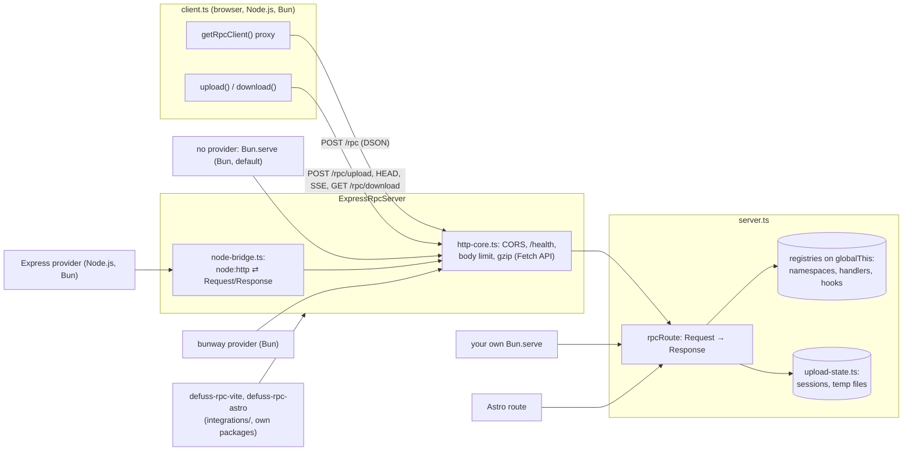
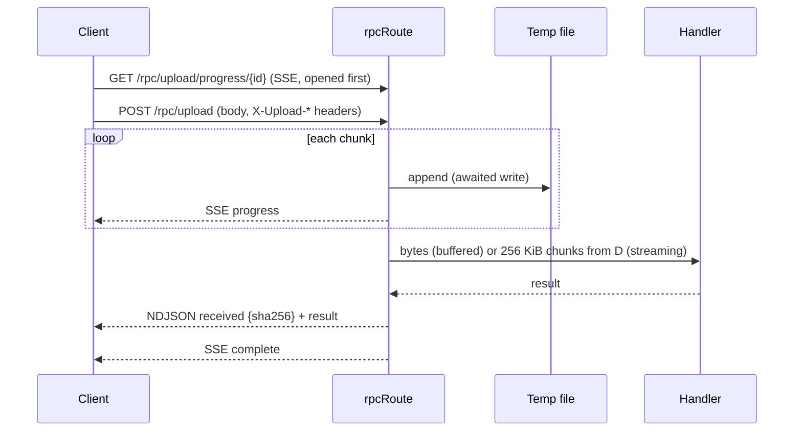

# defuss-rpc architecture

How the package is built and why. Usage is in [README.md](README.md); the runnable code is in [`examples/`](examples/).

## One Fetch handler, thin adapters

`rpcRoute` is a function from a Fetch API `Request` to a `Response`, which `Bun.serve`, Astro routes and the tests call directly. `ExpressRpcServer` adds what a standalone server needs (CORS, a health route, a body size limit, gzip and disconnect handling) and runs on `Bun.serve`, or on the framework of the provider it is given.

Why not Express routes as the core: a framework-specific core would need a second implementation for Bun and Astro, and the two would drift. VERIFIED: `scripts/e2e.mjs` runs the same demo API on `ExpressRpcServer` (Node.js) and `Bun.serve` (Bun) and compares the client's output line by line.

## Providers

A provider (`src/providers/*.ts`, contract in `src/provider.ts`) creates a framework's app, connects the server's HTTP layer to it and makes it listen. Without one, `ExpressRpcServer` takes `src/providers/bun.ts`: `Bun.serve` with one `fetch` handler, no framework. The HTTP layer, `http-core.ts`, works in Fetch API terms; `node-bridge.ts` connects Express (`node:http`) to it, and the bunway provider hands bunway's own `Request` to it directly.

Why providers instead of one built-in framework: the framework decides where the server runs. Express runs on Node.js and Bun; bunway exists only on `Bun.serve` (VERIFIED: Node.js cannot import bunway 1.1.0, whose files import each other without extensions) and answers small calls faster there (README.md, section Benchmark). With the framework behind a provider, `express-server.ts` imports neither, and an application loads only the one it imports.

Why `Bun.serve` is the default and Node.js has none: the default needs no framework package, and it answered the most small calls of every `ExpressRpcServer` setup and needed the least memory (VERIFIED: two `make bench` runs on 2026-11-02: 63,926 and 64,195 calls per second against bunway's 53,315 and 52,784, and 29 MiB idle and 59 MiB under calls against bunway's 38 and 70 MiB). A Node.js default would have to be Express, imported whether or not the application chose it, and what runs would depend on what is installed; the constructor throws on Node.js instead and names `expressProvider()`. The default provider sends every request through the core's `match()` instead of Bun's `routes`, so preflights for any path and CORS headers on the application's own responses (`getApp().fetch`) work as with the other providers. `.vae/checks/policy.py` fails when a module outside `src/providers/` imports a framework.

Why the HTTP layer is written in Fetch terms and not `node:http`: bunway has no `node:http` request or response, while every `node:http` request converts to a `Request`. One implementation then serves both, so limits and compression cannot drift between providers. VERIFIED: the server suites (`src/express-server.test.ts`, `src/client.test.ts`, `src/download.test.ts`) run on every provider, on Node.js and on Bun (`make test`).

Why the server reads call bodies itself instead of a framework body parser: each framework brings its own parser with its own size syntax, inflation and errors. The limit counts decompressed bytes, so a small gzip body cannot inflate past it.

What the bridge does for `node:http`:
- It forwards the body with `Readable.toWeb()`.
- After answering, it drains what nobody read. VERIFIED: without that, an unread 300 KB upload body (404) left Express waiting, and the client never got its answer.
- It waits for `drain` before writing more of a response.
- It cancels a response whose client disconnected.

The bunway provider calls `Bun.serve` itself instead of bunway's `listen()`, because Bun closes connections that send nothing for 10 s, and a stream can be quiet longer. The provider lifts that limit for NDJSON and Server-Sent Events responses only (`server.timeout(request, 0)`). bunway's WebSocket routes therefore need bunway's own `listen()`.

`scripts/bench.mjs` (`make bench`) compares the providers; README.md has the latest numbers. It also measures `rpcRoute` in a bare `Bun.serve`, which README.md and the website leave out of their tables: it runs without CORS, a body limit or the content-type check, so its numbers do not compare with a server that has them. It is the baseline for what the default provider's fetch handler and `http-core.ts` cost, the only code between the two setups (VERIFIED: 1.9 times the default's calls per second in both runs of 2026-11-02, 123,821 against 63,926 and 123,002 against 64,195, with the same 29 MiB idle).

Why one fixed default port (63920) instead of `0`: a client in another process finds a server that nobody configured. 63920 is in the dynamic range (49152 to 65535), which IANA never assigns to a service. A fixed port needs one fix that `0` hid, in the Vite plugin: Vite creates a restarted dev server before it closes the old one (integrations/vite/ARCH.md).

Why there is no defuss-express or tinyhttp provider: both were measured as providers, and neither gained enough to pay for its cost. VERIFIED by `make bench` on 2026-11-01 (defuss-express 0.3.5, @tinyhttp/app 3.0.14) and by the server suites:
- defuss-express (uWebSockets.js through ultimate-express 2.2.4) answered fewer small calls than Express on Node.js in that run (34,486 against 38,915 per second) and moved files about a fifth faster, inside that run's noise. It loads only on Node.js (Bun 1.4.3 throws at import), and it stalled about a third of the keep-alive requests after 1 MiB uploads unless the bridge read up to 64 MiB of each body ahead.
- tinyhttp was the slowest server on Node.js (25,043 calls per second) and within noise of Express on Bun.

## Calls

The client fetches `/rpc/schema` once per endpoint (`client.ts`, cached per `baseUrl`), then builds a caller per method: a single-response caller, or an async generator for methods the schema marks `generator: true`. The server classifies a method by its constructor name (`AsyncGeneratorFunction` etc.) in one function, `describeFn`, used for both the schema and the dispatch; so a method streams exactly when the client expects a stream. Why not "stream every iterable result": a `Uint8Array`, `Map` or `Set` result is iterable and would be streamed to a client that expects one value. VERIFIED: `src/server.test.ts` (round-trips DSON types).

Class namespaces are instantiated per call, so instance fields cannot leak between users; module namespaces are shared. Names of `Object.prototype` and `constructor` are never dispatched, so only what the API author wrote is callable.

Bodies are [DSON](https://github.com/kyr0/defuss-dson): JSON-compatible text that restores `Date`, `Map`, `Set`, `BigInt`, typed arrays, and, from defuss-dson 1.2.0, `undefined`, `NaN`, `Infinity`, `-Infinity` and `-0`, which JSON turns into `null`. VERIFIED: `src/client.test.ts` ("restores DSON types") on every provider. The server still accepts plain JSON call bodies from older clients.

Why defuss-rpc requires defuss-dson 1.2.0: the server decodes bodies from any client, and 1.2.0's `parse` no longer builds a global named by the input, takes no typed-array length from it, and keeps a `__proto__` key as an own property. VERIFIED: `src/server.test.ts` ("refuses DSON records that name a global or take a length from the body"); with 1.1.2 a call body carrying `["Function","return 1"]` ran the method with a function built from the request. A client with defuss-dson below 1.2.0 cannot read `NaN`, `±Infinity` or `-0` in an answer (record tag 9, defuss-dson's CHANGELOG); other values read the same in both versions.

## Streaming

A generator answers with NDJSON. The response stream pulls the next value from the generator only when the consumer reads, and its `cancel()` calls the generator's `return()`; so a slow client slows the producer and a disconnect runs the generator's `finally`. The `node:http` bridge cancels the body on the response's `close` event; `Bun.serve` cancels it itself. VERIFIED: `src/client.test.ts` ("break stops the server generator") on every provider.

## Uploads and downloads

The body goes to a temp file per upload while SHA-256 is computed, and the handler runs after the last byte. Why a temp file instead of memory: uploads may exceed RAM, the resume offset must be the number of bytes really stored (`HEAD` reports the file size), and the hash must be final when the handler starts. A streaming handler reads the file in 256 KiB chunks, so its memory is bounded. VERIFIED: `src/upload.test.ts` (chunk sizes, resume after a dropped connection, hash of the whole file).

The progress stream subscribes before the session exists, because a client opens it before the POST; a polling design missed every event of uploads faster than the poll interval (VERIFIED by the same test before the change). Browsers send a buffered body (`duplex: "half"` is not portable across browsers), so their `sending` progress is reported once; Node.js and Bun stream the body in chunks.

File names travel percent-encoded in `X-Original-Filename` (a header value outside Latin-1 makes `fetch` throw) and come back as RFC 6266 `filename*` in `Content-Disposition`. VERIFIED: `src/client.browser.test.ts` in Chromium and WebKit.

## Shared state

The registries (`server.ts`), upload sessions (`upload-state.ts`) and the client's default endpoint live on `globalThis` under `Symbol.for("defuss-rpc.*")` keys, as does the plugin state of defuss-rpc-vite. Why: one process can load these modules more than once. The ESM and CommonJS builds are separate modules, and Astro bundles packages that peer on `astro` (defuss-rpc-astro) into its SSR build, where its middleware runs a second module copy. VERIFIED: with module variables, `Astro.locals.rpcEndpoint` was empty in `astro dev`; `integrations/astro/src/index.test.ts` loads a second copy with `vi.resetModules()` and sees the upload handlers of the first.

## Vite and Astro

The Vite plugin and the Astro integration are packages of their own: `integrations/vite` (defuss-rpc-vite) and `integrations/astro` (defuss-rpc-astro), each a Bun project with its own lockfile, tests, README.md and ARCH.md. Why: defuss-rpc then depends on no build tool and no framework, and an application installs Vite or Astro only when it uses them. VERIFIED: `.vae/checks/policy.py` fails when `src/` imports vite or astro, or when package.json lists either as a dependency or peer; vite remains a devDependency only because Vitest 5 requires it as a peer to run the tests.

In this repository each integration reaches defuss-rpc (and defuss-rpc-astro reaches defuss-rpc-vite) through a relative symlink in its `node_modules`, which `make setup` creates. Why not Bun's own mechanisms: a `file:` dependency copied the whole repository and installed its devDependencies, astro included, and `link:` takes a package name registered globally, which another checkout or worktree can overwrite. VERIFIED by probes with Bun 1.4.3; the symlink survives later `bun install` runs.

## Operations

- Logs: one line per event from `src/log.ts`: ISO-8601 UTC timestamp, level, `defuss-rpc`, message, `key=value`. The library logs server start and stop and methods or handlers that threw; client errors (400, 403, 404) are answered, not logged.
- Limits: `jsonSizeLimit` (default 1 MB) bounds call bodies; uploads have no size limit of their own: add a guard (see `examples/hooks.ts`).
- State: upload sessions are in memory and temp files in `<os tmpdir>/defuss-uploads` (`setUploadDir()`); a successful handler run deletes its file, a failed one keeps it for a retry. Nothing expires abandoned uploads; clean the directory on deploy or restart.
- Runtimes: without a provider the server runs on Bun only; the Express provider runs on Node.js 22, 24 and 26 (the versions CI tests) and on Bun, the bunway provider on Bun.
- Ports: every server listens on 63920 unless given `port`; `make start` serves the static website on 4173 (`SITE_PORT`).
- Idle streams: VERIFIED on Bun 1.4.3: an NDJSON stream silent for 12 s, longer than `Bun.serve`'s 10 s default, reached the client complete on Express and bunway.

## Security

- Every function of a registered namespace is callable by any client that reaches the server; authorization belongs in a server guard, which receives the raw `Request`.
- Upload IDs are reduced to `[a-zA-Z0-9._-]{1,128}` before they become file names, so they cannot leave the upload directory. VERIFIED: `src/upload.test.ts`.
- `Content-Disposition` is built from an ASCII fallback plus the percent-encoded name, so a file name cannot inject header syntax.
- `ExpressRpcServer` allows any CORS origin by default; with a list it echoes only listed origins (with `Vary: Origin`).
- Call bodies are decoded by defuss-dson 1.2.0 or later, which refuses records that name a global or take an allocation size from the body (see Calls above).
- Calls run only with `Content-Type: application/json`: a cross-origin page can send `text/plain` or form bodies without a CORS preflight, and those get 400 without running anything.

## Privacy

The library stores nothing beyond the request: call arguments and results are not logged, and upload data stays in the temp directory only until the handler succeeded.

## Quality gates

`make verify` (and CI on Node.js 22, 24 and 26) runs:
- oxlint and strict TypeScript for `src/`, `examples/` and both integration packages;
- `scripts/docs.ts --check`: the READMEs and the website equal their example files, and no code block lacks one;
- `.vae/checks/policy.py`: exports, providers behind `src/providers/`, runtime claims, every example executed, commit trailers;
- Vitest in Node.js and Bun on every provider, and in Chromium and WebKit, with merged coverage; the integration packages' tests on Node.js and Bun;
- `scripts/e2e.mjs` against the packed tarballs of all three packages, with every demo server on Node.js and Bun and the Vite and Astro examples on Bun.
