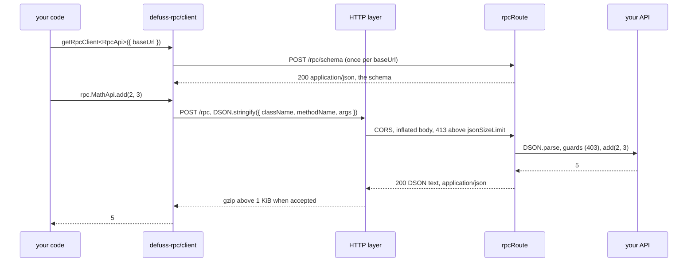
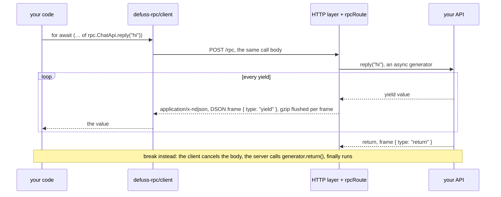
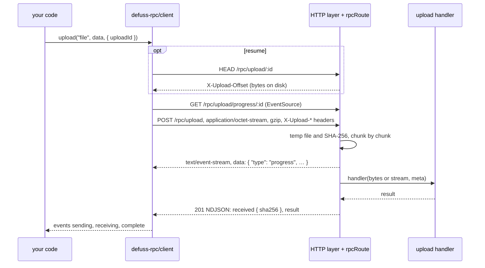
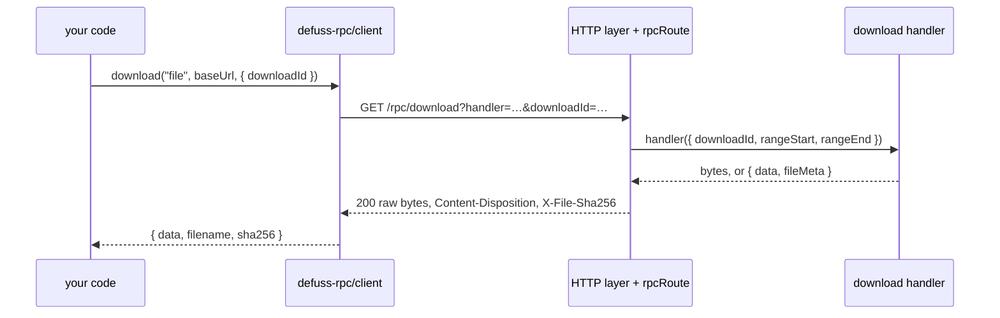

# defuss-rpc

[](https://github.com/kyr0/defuss-rpc/actions/workflows/verify.yml)
[](https://www.npmjs.com/package/defuss-rpc)
[](LICENSE)

The [defuss](https://github.com/kyr0/defuss) runtime's remote procedure calls: call server-side functions and classes as if they ran client-side.

defuss-rpc exposes them to the client as a fully typed, async API: the client builds it from the server's schema at runtime and takes its types from your server code. [defuss-dson](https://github.com/kyr0/defuss-dson) encodes and decodes every argument and result, so `Date`, `Map`, `Set`, `BigInt` and typed arrays arrive intact. Calls, one after another or in parallel, are plain HTTP with JSON bodies; async generators stream as NDJSON that you read with `for await`; files travel as raw bytes, uploads with progress, gzip, resume and SHA-256. Servers run on Bun (`Bun.serve`, Express or bunway), on Node.js (Express), and inside Vite and Astro through defuss-rpc-vite and defuss-rpc-astro. The project site in [`docs/`](docs/index.html) shows every example and how a call travels over the wire (`make start` serves it).

## TL;DR

You don't need a schema language, a code generator or a REST layer to call your server. Export an object of classes and modules, register it with `createRpcServer()`, serve `rpcRoute`, and call `getRpcClient<typeof RpcApi>()` on the client: the client fetches the schema once, builds a caller per method and types each one from your server code.

Features:
- 🧩 Classes and modules as APIs: a class gets a fresh instance per call, a module is shared; no decorators, no IDL
- 🔒 Typed end to end: `getRpcClient<typeof RpcApi>()` types every call, argument and result from the server's own export
- 🌊 Generators stream: an `async *` method sends each `yield` as an NDJSON frame; `break` on the client stops the server generator
- 🧬 Types JSON loses: `Date`, `Map`, `Set`, `BigInt`, `Uint8Array` and every typed array, plus `undefined`, `NaN`, `±Infinity` and `-0`, as arguments and results
- 📦 Files of any size: uploads stream to disk with SHA-256, gzip, Server-Sent Events progress and resume after a dropped connection; downloads carry name, type and hash
- 🛡️ Hooks at both ends: server guards answer 403 before a method runs; client hooks add headers, metrics and checks around every call
- 🌐 One Fetch handler: `rpcRoute` serves `Bun.serve` and Astro routes as it is; `ExpressRpcServer` adds CORS, gzip, limits and health checks
- 🔌 Bun first: without a provider `ExpressRpcServer` runs on `Bun.serve` at port 63920, and in `make bench` it answered the most calls with the least memory; import Express (Node.js and Bun) or bunway (Bun) as its provider only when you need one
- ⚡ Vite and Astro, optional: the packages defuss-rpc-vite and defuss-rpc-astro start the RPC server beside `vite dev` and `astro dev` and tell the client where it is; defuss-rpc needs neither
- 🧪 Tested where it runs: Vitest in Node.js, Bun, Chromium and WebKit on every provider, plus an end-to-end run of the packed package and every documented example on Node.js and Bun
- 🟦 Written in TypeScript; ESM and CommonJS builds

## Install

We recommend [`bun`](https://bun.sh) as package manager, script runner and server runtime:

```bash
bun add defuss-rpc
```

On Bun that is all you need: without a provider, `ExpressRpcServer` runs on `Bun.serve`, the setup that answered the most calls with the least memory in the [Benchmark](#benchmark). Everything else is optional:

```bash
# Optional: a framework provider, for Node.js or for a framework's routes and middleware
bun add express            # expressProvider: Node.js and Bun (TypeScript: bun add -d @types/express)
bun add bunway             # bunwayProvider: Bun only
# Optional: let a dev server you already use start the RPC server
bun add defuss-rpc-vite                    # Vite
bun add defuss-rpc-astro defuss-rpc-vite   # Astro
# with npm instead of bun: npm install defuss-rpc express
```

Entry points: `defuss-rpc/client`, `defuss-rpc/server`, `defuss-rpc/express-server`, and `defuss-rpc/providers/*` (one per provider); each also resolves with a `.js` suffix, as in earlier releases. The optional Vite plugin and Astro integration are the packages [defuss-rpc-vite](integrations/vite/README.md) and [defuss-rpc-astro](integrations/astro/README.md).

## Quick start

Three files: the API, a server, a client. They are [`examples/api.ts`](examples/api.ts), one of the `examples/server-*.ts` files, and [`examples/client.ts`](examples/client.ts); the end-to-end test runs them against the packed package on both runtimes and compares every printed line with its comment.

### 1. Define the API

<!-- example: examples/api.ts#api -->
```ts
/** A module: plain functions on one shared object. */
export const MathApi = {
  async add(a: number, b: number) {
    return a + b;
  },
  async multiply(a: number, b: number) {
    return a * b;
  },
};

/**
 * A class: the server creates a fresh instance for every call, so
 * fields never leak between requests.
 */
export class GreeterApi {
  async greet(name: string) {
    return `Hello, ${name}!`;
  }
}

/**
 * An async generator streams: the client receives every `yield`
 * as it happens.
 */
export const ChatApi = {
  async *reply(prompt: string) {
    for (const word of `You said: ${prompt}`.split(" ")) {
      await new Promise((resolve) => setTimeout(resolve, 40));
      yield word;
    }
    return "done";
  },
};

/**
 * DSON keeps the types JSON loses: Date, Set, Map, BigInt and
 * typed arrays.
 */
export const TypesApi = {
  async sample() {
    return {
      when: new Date("2026-11-01T12:00:00.000Z"),
      tags: new Set(["rpc", "dson"]),
      scores: new Map([["ada", 1815]]),
      big: 2n ** 64n,
      bytes: new Uint8Array([222, 173, 190, 239]),
    };
  },
};

/** Which runtime answers: the same API runs on Node.js and Bun. */
export const ServerInfo = {
  async runtime() {
    const { bun, node } = process.versions;
    return bun ? `Bun ${bun}` : `Node.js ${node}`;
  },
};

const RpcApi = { MathApi, GreeterApi, ChatApi, TypesApi, ServerInfo };
export default RpcApi;
export type RpcApi = typeof RpcApi;
```
<!-- /example -->

### 2. Serve it

`ExpressRpcServer` serves every endpoint with CORS, gzip, body limits and `/health`. Without a provider it runs on `Bun.serve` and listens on port 63920:

<!-- example: examples/server-bun.ts#server-bun -->
```ts
import { createRpcServer } from "defuss-rpc/server";
import { ExpressRpcServer } from "defuss-rpc/express-server";
import RpcApi from "./api.ts";
import "./files.ts";
import "./hooks.ts";

createRpcServer(RpcApi);

// No provider: Bun.serve, without a framework. On Node.js, select
// one (server-express.ts).
const server = new ExpressRpcServer({
  host: "127.0.0.1",
  // undefined: the default port, 63920
  port: process.env.PORT ? Number(process.env.PORT) : undefined,
});
// Requests outside the RPC routes go to one fetch handler (default:
// 404); add your own before start().
server.getApp().fetch = (request) =>
  new URL(request.url).pathname === "/version"
    ? Response.json({ version: 1 })
    : new Response("Not Found", { status: 404 });
await server.start(); // listening at http://127.0.0.1:63920
```
<!-- /example -->

Stay on this default unless you run on Node.js or need a framework's routes and middleware: in `make bench` it answered the most calls of every `ExpressRpcServer` setup with the least memory (table below). For those cases, import a provider; nothing else changes:

<!-- example: examples/server-express.ts#server-express -->
```ts
import { createRpcServer } from "defuss-rpc/server";
import { ExpressRpcServer } from "defuss-rpc/express-server";
import { expressProvider } from "defuss-rpc/providers/express";
import RpcApi from "./api.ts";
import "./files.ts";
import "./hooks.ts";

createRpcServer(RpcApi);

const server = new ExpressRpcServer({
  provider: expressProvider(), // Express 5 on node:http: Node.js and Bun
  host: "127.0.0.1",
  port: Number(process.env.PORT ?? 63920),
});
// Your own Express routes and middleware live on the same app;
// add them before start().
server.getApp().get("/version", (_req, res) => void res.json({ version: 1 }));
await server.start(); // listening at http://127.0.0.1:63920
```
<!-- /example -->

| Provider | Import | Runs on | Install | calls/s | RSS idle / under calls | Choose it for |
| --- | --- | --- | --- | ---: | ---: | --- |
| none (default) | | Bun | nothing | 63,926 | 29 / 59 MiB | everything on Bun; `getApp().fetch` answers your own routes |
| `bunwayProvider()` | `defuss-rpc/providers/bunway` | Bun | `bunway` | 53,315 | 38 / 70 MiB | the Express API on `Bun.serve` |
| `expressProvider()` | `defuss-rpc/providers/express` | Bun | `express` 5 | 41,437 | 46 / 163 MiB | an existing Express app and its middleware |
| `expressProvider()` | `defuss-rpc/providers/express` | Node.js | `express` 5 | 32,784 | 98 / 243 MiB | Node.js, where there is no default |

Numbers from one `make bench` run (2026-11-02, see [Benchmark](#benchmark)): small calls per second and the server process's resident memory, idle and under that load.

Each has a runnable file: [`server-bun.ts`](examples/server-bun.ts), [`server-express.ts`](examples/server-express.ts), [`server-bunway.ts`](examples/server-bunway.ts). On Node.js there is no default: the constructor throws and names `expressProvider()`, because a default there would have to import a framework the application did not choose. `server.getApp()` returns the provider's app for your own routes, as both examples above show. Every server listens on port 63920 (`DEFAULT_PORT`) unless you pass `port`; `0` picks a free one.

A `Bun.serve` you already run can mount `rpcRoute` itself, a plain Fetch handler; the CORS headers are then yours to add:

<!-- example: examples/server-route.ts#server-route -->
```ts
import { createRpcServer, rpcRoute } from "defuss-rpc/server";
import RpcApi from "./api.ts";
import "./files.ts";
import "./hooks.ts";

createRpcServer(RpcApi);

// rpcRoute answers requests; CORS for browser pages on other
// origins is the server's job.
const cors = {
  "Access-Control-Allow-Origin": "*",
  "Access-Control-Expose-Headers":
    "Content-Disposition, X-File-Sha256, X-Upload-Offset",
};

const server = Bun.serve({
  hostname: "127.0.0.1",
  port: Number(process.env.PORT ?? 63920),
  // seconds: streams and upload progress keep a request open
  // longer than Bun's default of 10
  idleTimeout: 120,
  async fetch(request) {
    if (request.method === "OPTIONS") {
      const allowHeaders =
        request.headers.get("Access-Control-Request-Headers") ??
        "Content-Type";
      return new Response(null, {
        headers: { ...cors, "Access-Control-Allow-Headers": allowHeaders },
      });
    }
    const response = await rpcRoute({ request });
    for (const [name, value] of Object.entries(cors)) {
      response.headers.set(name, value);
    }
    return response;
  },
});
```
<!-- /example -->

In an Astro project without the integration, the same handler is a route: `export const ALL = rpcRoute;` in `src/pages/rpc/[...all].ts`.

### 3. Call it

<!-- example: examples/client.ts#client -->
```ts
import {
  addHook,
  download,
  getRpcClient,
  setHeaders,
  uploadComplete,
} from "defuss-rpc/client";
import type { RpcApi } from "./api.ts";

const baseUrl = process.env.RPC_URL ?? "http://127.0.0.1:63920";
const rpc = await getRpcClient<RpcApi>({ baseUrl });

console.log(await rpc.MathApi.add(2, 3)); // 5
console.log(await new rpc.GreeterApi().greet("Ada")); // Hello, Ada!
```
<!-- /example -->

`baseUrl` falls back to the endpoint that `virtual:defuss-rpc` of defuss-rpc-vite registered, then to the page's own origin. The schema is cached per endpoint; `clearSchemaCache()` forgets it after the server's API changed.

## Streaming and types

A generator method answers with `application/x-ndjson`, one frame per `yield`, then the return value. The server pulls the next value only when the client reads, so a slow client slows the generator instead of filling memory.

<!-- example: examples/client.ts#stream -->
```ts
const words: string[] = [];
for await (const word of rpc.ChatApi.reply("hi there")) {
  words.push(word);
}
console.log(words.join(" ")); // You said: hi there
```
<!-- /example -->

This is the body of that call on the wire, each line DSON's compact encoding of `{ type, value }`:

<!-- example: examples/wire.ndjson -->
```json
[[2,[[1,2],[3,4]]],[0,"type"],[0,"yield"],[0,"value"],[0,"You"]]
[[2,[[1,2],[3,4]]],[0,"type"],[0,"yield"],[0,"value"],[0,"said:"]]
[[2,[[1,2],[3,4]]],[0,"type"],[0,"yield"],[0,"value"],[0,"hi"]]
[[2,[[1,2],[3,4]]],[0,"type"],[0,"yield"],[0,"value"],[0,"there"]]
[[2,[[1,2],[3,4]]],[0,"type"],[0,"return"],[0,"value"],[0,"done"]]
```
<!-- /example -->

A generator that throws ends the stream with an `error` frame, which the client throws from its loop. Every other method answers with one DSON body, which restores the types:

<!-- example: examples/client.ts#types -->
```ts
const { when, tags, scores, big, bytes } =
  await rpc.TypesApi.sample();
console.log(when.toISOString()); // 2026-11-01T12:00:00.000Z
console.log(tags.has("dson"), scores.get("ada")); // true 1815
console.log(big); // 18446744073709551616n
console.log(bytes instanceof Uint8Array); // true
```
<!-- /example -->

A top-level `undefined` result arrives as `null`, as in JSON.

## Files

Register handlers by name on the server. A buffered handler gets a `Uint8Array`; `addStreamingUploadHandler()` hands over a `ReadableStream` that reads the stored upload in 256 KiB chunks, for files larger than memory.

<!-- example: examples/files.ts#files -->
```ts
import {
  addDownloadHandler,
  addUploadHandler,
} from "defuss-rpc/server";

interface StoredFile {
  data: Uint8Array;
  name: string;
}

/** The last 20 files: a demo must not grow without bound. */
const files = new Map<string, StoredFile>();

addUploadHandler("file", (data, meta) => {
  const { uploadId: id, originalFilename, sha256 } = meta;
  const name = originalFilename || `${id}.bin`;
  files.set(id, { data, name });
  if (files.size > 20) files.delete(files.keys().next().value!);
  return { id, size: data.byteLength, sha256 };
});

addDownloadHandler("file", ({ downloadId }) => {
  const file = files.get(downloadId);
  if (!file) throw new Error(`Unknown file ${downloadId}`);
  return {
    data: file.data,
    fileMeta: {
      size: file.data.byteLength,
      contentType: "application/octet-stream",
      filename: file.name,
    },
  };
});
```
<!-- /example -->

From Node.js or Bun:

<!-- example: examples/client.ts#upload -->
```ts
type StoredFile = { id: string; size: number };
const data = new TextEncoder().encode("hello, file");
const { result, sha256 } = await uploadComplete<StoredFile>(
  "file",
  data,
  { baseUrl, originalFilename: "hello.txt" },
);
console.log(result.size, sha256.length); // 11 64

const file = await download("file", baseUrl, {
  downloadId: result.id,
});
const text = new TextDecoder().decode(file.data);
console.log(text, file.filename); // hello, file hello.txt
```
<!-- /example -->

In the browser, with progress; the end-to-end test runs exactly this code in Chromium and WebKit:

<!-- example: examples/browser.ts#browser-upload -->
```ts
import { downloadAsBlob, upload } from "defuss-rpc/client";

export interface StoredFile {
  id: string;
  size: number;
  sha256: string;
}

/**
 * Uploads a File and reports progress: "sending" from the browser,
 * "receiving" from the server's SSE stream.
 */
export async function sendFile(
  file: File,
  baseUrl: string,
  onProgress: (phase: string, percent: number) => void,
) {
  const options = { baseUrl, originalFilename: file.name };
  for await (const event of upload<StoredFile>("file", file, options)) {
    if (event.type === "complete") return event;
    onProgress(event.type, event.percent);
  }
  throw new Error("upload ended without a result");
}

/** Fetches the file back as a Blob, for an object URL or a save link. */
export async function fetchFile(id: string, baseUrl: string) {
  const { blob, result } = await downloadAsBlob("file", baseUrl, {
    downloadId: id,
  });
  return { blob, filename: result.filename ?? `${id}.bin` };
}
```
<!-- /example -->

| `upload()` event | Fields | When |
| --- | --- | --- |
| `sending` | `bytesSent`, `totalBytes`, `percent` | Node.js and Bun: per chunk of the streamed body. Browsers: once, after the buffered body was sent (a streamed request body is not portable across browsers) |
| `receiving` | `bytesReceived`, `totalBytes`, `percent` | where `EventSource` exists (browsers): bytes the server stored, from `GET /rpc/upload/progress/{uploadId}` |
| `complete` | `result`, `uploadId`, `bytesReceived`, `sha256`, `durationMs` | once, with the handler's return value and the server's SHA-256 of the content |

`upload()` options: `baseUrl`, `compression` (`"auto"` default and `"gzip"` use `CompressionStream`, `"none"` for already compressed data), `chunkSize` (256 KiB), `uploadId` (pass the ID of an interrupted upload to resume: the client asks `HEAD /rpc/upload/{id}` for the stored size and sends only the rest), `signal`, `headers`, `progress` (`false` skips the SSE stream) and `originalFilename` (any Unicode; sent percent-encoded). `uploadComplete()` resolves with the final result only.

Download handlers return a `Uint8Array` or `{ data, fileMeta }` (`size`, `contentType`, `filename`, `sha256`, `lastModified`); `addStreamingDownloadHandler()` returns `{ stream, fileMeta }`. `download()` resolves with the bytes in `data` plus `filename`, `contentType` and the handler's `sha256`; `downloadAsBlob()` returns a `Blob`. Neither uses `setHeaders()`: pass `headers` per call.

## Hooks

<!-- example: examples/hooks.ts#hooks -->
```ts
import { addHook } from "defuss-rpc/server";

const MAX_UPLOAD_BYTES = 50 * 1024 * 1024;

// Guards run before every call, upload and download; returning
// false answers HTTP 403. For uploads the namespace is
// "__upload__" and args[0] is the size the client announced.
addHook({
  phase: "guard",
  fn: (namespace, _method, args) => {
    if (namespace !== "__upload__") return true;
    return Number(args[0]) <= MAX_UPLOAD_BYTES;
  },
});
```
<!-- /example -->

A server guard gets `(namespace, method, args, request)`; only an explicit `false` rejects. A `"result"` hook also gets the return value; it does not run for generator methods (their values are streamed) and runs with `undefined` after an upload handler threw. Downloads use the namespace `"__download__"` and `args = [downloadId]`.

<!-- example: examples/client.ts#client-hooks -->
```ts
// sent with every later call and upload
setHeaders({ Authorization: "Bearer demo-token" });
let answered = 0;
// runs after each decoded result
addHook({ phase: "result", fn: () => void answered++ });
await rpc.MathApi.multiply(6, 7);
console.log(answered); // 1
```
<!-- /example -->

A client guard must return `true`: any other value (also `undefined`) aborts the call before it is sent. `"response"` hooks see the raw `Response`, `"result"` hooks the decoded value. `clearHooks()` removes all hooks and headers.

## Vite and Astro

**Optional: you need neither.** defuss-rpc runs on its own, as [Serve it](#2-serve-it) shows. Use these only when your app already runs on Vite or Astro and its dev server should start the RPC server for you. They are two packages of their own, so that defuss-rpc depends on no build tool and no framework: [defuss-rpc-vite](integrations/vite/README.md) starts an `ExpressRpcServer` beside `vite dev` and serves `virtual:defuss-rpc`, which registers that server as the client's default endpoint; [defuss-rpc-astro](integrations/astro/README.md) wraps the plugin and adds `Astro.locals.rpcEndpoint`. Without a provider, the RPC server runs on `Bun.serve` at port 63920, so the dev server runs on Bun (`bunx --bun vite`, `bunx --bun astro dev`).

```bash
bun add defuss-rpc-vite                    # Vite
bun add defuss-rpc-astro defuss-rpc-vite   # Astro
```

<!-- example: integrations/vite/example/vite.config.ts#vite-config -->
```ts
import { defineConfig } from "vite";
import { defussRpc } from "defuss-rpc-vite";
import RpcApi from "./api.ts";

// No provider: the RPC server runs on Bun.serve, port 63920.
// On Node.js add `provider: expressProvider()`.
export default defineConfig({
  plugins: [
    defussRpc({
      api: RpcApi,
      host: "127.0.0.1",
      watch: ["api.ts"],
    }),
  ],
});
```
<!-- /example -->

<!-- example: integrations/astro/example/astro.config.ts#astro-config -->
```ts
import { defineConfig } from "astro/config";
import { defussRpc } from "defuss-rpc-astro";
import RpcApi from "./api.ts";

export default defineConfig({
  // No provider: the RPC server runs on Bun.serve, port 63920.
  // On Node.js add `provider: expressProvider()`.
  integrations: [
    defussRpc({
      api: RpcApi,
      host: "127.0.0.1",
      watch: ["api.ts"],
    }),
  ],
});
```
<!-- /example -->

Their READMEs show the client side and list the options.

## Runtimes

| Part | Browsers | Node.js 22, 24, 26 | Bun |
| --- | --- | --- | --- |
| Client: calls, streams, uploads, downloads | Chromium, WebKit | yes | yes |
| `rpcRoute` (Fetch handler) | n/a | yes | yes, with `Bun.serve` |
| `ExpressRpcServer` without a provider | n/a | no: the constructor throws and names `expressProvider()` | yes, on `Bun.serve` |
| `ExpressRpcServer` on `expressProvider()` | n/a | yes | yes |
| `ExpressRpcServer` on `bunwayProvider()` | n/a | no: bunway runs on `Bun.serve` | yes |
| defuss-rpc-vite, defuss-rpc-astro | n/a | yes, with a provider (Vitest) | yes: `vite` and `astro dev` without a provider (e2e); the Vite plugin on every provider (Vitest) |

`make test` runs the server suites on Node.js with Express, then again on Bun (`bunx --bun vitest`) with no provider, Express and bunway, and the browser suites in Chromium and WebKit against Express on Node.js. Plain `bun test` starts Bun's own runner instead of Vitest; use `make test`.

## Benchmark

| Server | call req/s | call p50 / p99 ms | stream (100 frames) req/s | upload (1 MiB each) | download (8 MiB each) | RSS idle / calls / peak |
| --- | ---: | ---: | ---: | ---: | ---: | ---: |
| express on Node.js | 32,784 | 1 / 3 | 7,760 | 1257.6 MiB/s | 8596 MiB/s | 98 / 243 / 433 MiB |
| express on Bun | 41,437 | 1 / 3 | 10,426 | 1497 MiB/s | 8466.4 MiB/s | 46 / 163 / 343 MiB |
| bunway on Bun | 53,315 | 1 / 2 | 11,738 | 1603.8 MiB/s | 8403.6 MiB/s | 38 / 70 / 455 MiB |
| no provider (Bun.serve) on Bun | 63,926 | 0 / 2 | 12,206 | 1626.2 MiB/s | 8483.6 MiB/s | 29 / 59 / 421 MiB |
| bare rpcRoute in Bun.serve on Bun | 123,821 | 0 / 1 | 13,625 | 1656.6 MiB/s | 8700 MiB/s | 29 / 68 / 414 MiB |

Measured 2026-11-02T05:14:14.247Z on Apple M5 Max, 18 cores, 48 GiB, darwin arm64; Node.js v26.11.1, Bun 1.4.3; 5 s per scenario after 1 s warm-up, 64 connections (uploads and downloads 16), autocannon with 4 worker threads on the same machine (load average 6.3 before the run). RSS is the server process's resident set size from `ps`: idle after start, the peak under the call load, and the peak over all four scenarios.

What the numbers show, in this run and in a second one right before it (load average 4.4):
- Without a provider, `ExpressRpcServer` answered the most small calls of every `ExpressRpcServer` setup in both runs (63,926 and 64,195 per second; bunway 53,315 and 52,784; Express on Bun 41,437 and 41,680; Express on Node.js 32,784 and 33,237), with a p99 latency of 2 and 1 ms, against 2 ms for bunway and 3 ms for Express.
- It also needed the least memory in both runs: 29 MiB idle and 59 MiB under the call load, against 38 and 70 MiB for bunway, 45 to 46 and 163 MiB for Express on Bun, and 98 and 243 MiB for Express on Node.js.
- For streams the default led bunway by 4 to 5 percent in both runs (12,206 and 12,113 against 11,738 and 11,545 per second). Every server moved 1.2 to 1.6 GiB/s up and 8.2 to 8.6 GiB/s down; of the `ExpressRpcServer` setups, Express on Node.js downloaded fastest in both runs, 1 to 3 percent ahead of the default.
- The peak memory while moving files (16 connections, 1 MiB uploads and 8 MiB downloads) was 340 to 460 MiB for every server and did not rank the same in both runs; Express on Bun had the lowest peak in both (343 MiB).
- `rpcRoute` in a bare `Bun.serve` answered 1.9 times as many small calls as `ExpressRpcServer` without a provider (123,821 against 63,926; 123,002 against 64,195), with the same idle memory. That gap is what `ExpressRpcServer` adds on top: CORS, routing, body reading and the size limit.
- The load average was 6.3 and 4.4 before the two runs; compare rows of one run, not runs of different machines.

`make bench` measures this on your machine: `scripts/bench.mjs` starts each server in its own process and loads it with [autocannon](https://github.com/mcollina/autocannon) for 5 s per scenario (`BENCH_DURATION`), after checking one answer of each. Compare rows of one run; the load generator shares the machine with the server.

## Protocol

Plain HTTP with four body formats: DSON for calls, NDJSON for generators and upload answers, raw bytes for files, Server-Sent Events for upload progress. `ExpressRpcServer` is the HTTP layer below; with `rpcRoute` in your own `Bun.serve` or an Astro route, your server takes its place.

| Layer | Calls | Generators | Uploads | Downloads |
| --- | --- | --- | --- | --- |
| your code and the client | typed values: `Date`, `Map`, `Set`, `BigInt`, typed arrays | `for await` over the values | an async iterator of `sending`, `receiving`, `complete` | `{ data, filename, sha256 }` or a Blob |
| wire (HTTP) | `POST /rpc`: DSON text as `application/json` | `application/x-ndjson`: one DSON frame per line, `yield`, then `return` or `error` | `POST /rpc/upload`: raw bytes (`application/octet-stream`, gzip) and `X-Upload-*` headers; progress as Server-Sent Events with JSON data; the answer as NDJSON | `GET /rpc/download`: raw bytes; `Content-Disposition` (RFC 6266) and `X-File-Sha256` |
| HTTP layer | CORS; inflates gzip and deflate bodies; 413 above `jsonSizeLimit`; gzip above 1 KiB | gzip flushed after every frame | no size limit; progress events are never compressed | passed through, never compressed |
| `rpcRoute` and your API | `DSON.parse` gives the arguments, `DSON.stringify` the answer | the generator is pulled once per read | the handler runs after the last byte, with the bytes or a chunked stream | the handler returns bytes, or a stream, with `fileMeta` |

A call fetches the schema once per `baseUrl`, then sends one `POST` per call. A class gets a new instance per call; a module is shared.



A generator answers with one NDJSON frame per `yield`; the server pulls the next value only when the client reads, and a `break` cancels the response, which runs the generator's `finally`.



An upload sends raw bytes; the server writes them to a temp file while it hashes them, then runs the handler. `HEAD` happens only when an `uploadId` resumes an upload.



A download is one `GET`; name and hash travel in the headers, and the server never compresses the bytes.



[`examples/wire.ndjson`](examples/wire.ndjson) holds a generator's raw answer as the e2e test receives it.

## Endpoints

`rpcRoute` routes on the end of the path, so any prefix works. `ExpressRpcServer` mounts the same routes under `basePath`, adds `GET|POST /health`, and passes every other path on to its framework.

| Method | Path | Answer |
| --- | --- | --- |
| any | `/rpc/schema` | JSON array of `{ kind: "class", className, methods, properties }` and `{ kind: "module", moduleName, methods }`, each method `{ async, generator }` |
| `POST` | `/rpc` | body `{ className, methodName, args }` (DSON or JSON); a DSON result or NDJSON frames |
| `POST` | `/rpc/upload` | headers `X-Upload-Handler`, `X-Upload-Id`, `X-Original-Size`, `X-Upload-Offset`, `X-Original-Filename`, `Content-Encoding`; NDJSON `received` + `result` (201) or `error` (200) |
| `HEAD` | `/rpc/upload/{uploadId}` | `X-Upload-Offset`, `X-Upload-Handler`, `X-Original-Size`, `X-Upload-Status`; 404 when unknown |
| `GET` | `/rpc/upload/progress/{uploadId}` | Server-Sent Events: `progress`, then `complete` or `error` |
| `GET` | `/rpc/download?handler=…&downloadId=…` | the file with `Content-Type`, `Content-Length`, `Content-Disposition`, `X-File-Sha256` |

Status codes: 400 malformed call body (or a call without `Content-Type: application/json`), 403 a guard returned `false`, 404 unknown namespace, method or handler, 409 resume offset mismatch, 413 call body above `jsonSizeLimit`, 415 unknown `Content-Encoding`, 500 the method or handler threw (message in `error`). Names on `Object.prototype` and `constructor` are never callable.

## Vibe coding

Paste this prompt into your coding agent:

```text
Add defuss-rpc to this app: https://github.com/kyr0/defuss-rpc
Read its README.md and examples/ first. Install it with bun add defuss-rpc; on Node.js add express for its provider.
Export one object of API classes and modules plus `export type RpcApi = typeof RpcApi`, register it with createRpcServer(), and serve it with new ExpressRpcServer() on Bun (Bun.serve, port 63920) or new ExpressRpcServer({ provider: expressProvider() }) on Node.js (import from defuss-rpc/providers/express), or with defussRpc() from defuss-rpc-vite or defuss-rpc-astro, which take the same options.
On the client call getRpcClient<RpcApi>({ baseUrl }), use async generators for streams, upload()/download() for files, and server guard hooks for authorization.
```

Give your agent the [defuss-vae](https://github.com/kyr0/defuss-vae) skills too: it then plans, tests and reviews against a verifier instead of declaring itself done. In Claude Code, the plugin adds the commit and Stop-hook gate. Needs `python3` 3.9 or newer, `git` and `make`.

```bash
npx skills add kyr0/defuss-vae --skill '*'
# Claude Code plugin:
claude plugin marketplace add kyr0/defuss-vae
claude plugin install defuss-vae@defuss-vae
```

## Examples

[`examples/`](examples/) and the integrations' `example/` folders hold every snippet of this README and the website as runnable files, and `make e2e` runs them from the packed packages:

| File | What it shows | Run by the e2e test |
| --- | --- | --- |
| `api.ts`, `files.ts`, `hooks.ts` | the demo API, upload and download handlers, an upload guard | in every server below |
| `server-express.ts` | the API on `ExpressRpcServer` with Express, plus one Express route of its own | started on Node.js and on Bun |
| `server-bunway.ts` | the API on `ExpressRpcServer` with bunway | started on Bun |
| `server-bun.ts` | the API on `ExpressRpcServer` without a provider (`Bun.serve`), plus one route of its own | started on Bun |
| `server-route.ts` | `rpcRoute` in a hand-written `Bun.serve` | started on Bun |
| `client.ts` | calls, streams, types, files, hooks; each `console.log` states its output | on Node.js and Bun, against every server |
| `browser.ts` | upload with progress, download as Blob | in Chromium and WebKit, against every server |
| `integrations/vite/example/`, `integrations/astro/example/` | the plugin and the integration, without a provider | `vite` and `astro dev` on Bun, opened in Chromium |

The project site [`docs/index.html`](docs/index.html) shows the same files, highlighted, and the sequence diagrams of [Protocol](#protocol). It is static: no RPC server runs behind it. `make start` serves it at <http://127.0.0.1:4173/> on Bun; `make docs` regenerates its code blocks from `examples/`.

## Two things to know

**Guards are your trust boundary.** Every exported method of a registered namespace is callable by anyone who reaches the server, with arguments the client chose. Authenticate and authorize in a server guard (it sees the raw `Request`), validate arguments in the method, and keep internal helpers out of the namespace object. `ExpressRpcServer` allows any CORS origin by default; set `corsOrigin` for a browser-facing production server.

**Upload state lives in one process.** Temp files go to `<os tmpdir>/defuss-uploads` (`setUploadDir()` changes it) until the handler succeeded; sessions are kept in memory, so a resume must reach the same process, and a restart forgets unfinished uploads. Behind a load balancer, pin uploads to one instance.

## Development

```bash
make setup && make verify
```

`make verify` runs oxlint, strict TypeScript and the docs check, the Vitest suites in Node.js, Bun, Chromium and WebKit with coverage, and the end-to-end test of the packed package (every server on Node.js and Bun, both clients, the browser example, Vite, Astro and the website in Chromium and WebKit). `make bench` compares the providers; `make start` serves the website. [ARCH.md](ARCH.md) explains the design for contributors.

## License

[MIT](LICENSE)
