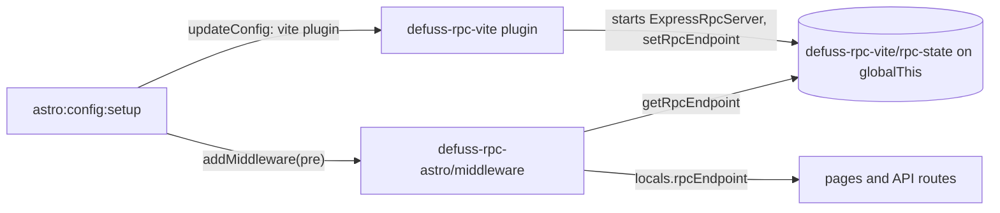

# defuss-rpc-astro: architecture

`astro:config:setup` saves the options, adds the Vite plugin of defuss-rpc-vite and a `pre` middleware. In `astro dev` the plugin starts the RPC server and serves `virtual:defuss-rpc`; the middleware writes the endpoint into `Astro.locals.rpcEndpoint` before any user middleware runs.

Why an integration on top of the Vite plugin: Astro runs Vite, so the plugin already starts the server and tells client scripts where it is; the integration adds the one thing Vite cannot, the endpoint in `locals` for server-rendered code (frontmatter, API routes), which Astro passes per request.

Why a package of its own: defuss-rpc imports no framework, and only Astro projects install this package and Astro.

Why the middleware reads the shared state of defuss-rpc-vite and not a module variable: Astro bundles packages that peer on `astro` into its SSR build, so the middleware runs in another module copy than the integration. VERIFIED: `src/index.test.ts` loads a second copy with `vi.resetModules()` and reads the endpoint and the upload handlers of the first; the repository's e2e test reads `Astro.locals.rpcEndpoint` (http://127.0.0.1:63920) from `astro dev` on Bun.

In a production server (`astro build` with an SSR adapter), no Vite plugin runs; the middleware starts the RPC server on the first request from the options `astro:config:setup` saved, once for concurrent first requests. VERIFIED: `src/index.test.ts` starts one server for two concurrent first requests; no test in the repository runs the middleware behind an SSR adapter, so that path is untested.

Why the peer dependencies on defuss-rpc and defuss-rpc-vite are marked optional: the same reason as in defuss-rpc-vite's ARCH.md; in this repository both are linked folders, and Bun would fetch a required peer from npm.

## Operations

- Logs: the RPC server logs through defuss-rpc; the integration itself logs nothing.
- Runtimes: without a provider the RPC server runs on `Bun.serve`, so `astro dev` must run on Bun (`bunx --bun astro dev`). VERIFIED: the repository's e2e test runs the example that way. On Node.js, pass `provider: expressProvider()`; `src/index.test.ts` uses Express on Node.js and Bun.
- `astro dev` detaches into a background process when it detects a coding agent; `--ignore-lock` keeps it in the foreground. VERIFIED: astro 7.4.4 (`dist/cli/dev/index.js`), used by the repository's e2e test.

## Security

As with defuss-rpc-vite: the RPC server serves the whole registered API on its port. In production, authorize in a defuss-rpc server guard and set `corsOrigin`.

## Privacy

The integration sends nothing anywhere; it only writes the RPC server's URL into `locals`.
