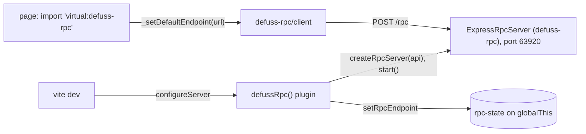

# defuss-rpc-vite: architecture

The plugin starts an `ExpressRpcServer` in `configureServer` and serves `virtual:defuss-rpc`, which calls `_setDefaultEndpoint()` with the running server's URL. It excludes `defuss-rpc` from dependency pre-bundling, so app code and the virtual module share one client module. A change to a watched file reloads the page. When Vite restarts after a change to `vite.config.ts` or its imports, `configureServer` replaces the API registry.

Why a separate server and not Vite middleware: the RPC server is the same `ExpressRpcServer` in development and production, with the same streaming, upload and CORS behavior, so `vite dev` is no special case.

Why a package of its own: defuss-rpc imports no build tool, and only applications that use Vite install this plugin and Vite. VERIFIED: the defuss-rpc package lists neither vite nor astro as a dependency or peer (`.vae/checks/policy.py` in the repository).

Why the plugin stops the previous RPC server before it starts one: the default port is fixed (63920), and Vite creates the restarted dev server before it closes the old one, so the new server would find its port taken. VERIFIED: `restartServer()` in vite 8.3.5 (`dist/node/chunks/node.js`) runs `configureServer` before `_closeServer`; `src/index.test.ts` ("restarts on a fixed port") fails without the stop. Two dev servers at once need `port: 0` or distinct ports.

Why the state lives on `globalThis` (`rpc-state.ts`, key `Symbol.for("defuss-rpc.rpc-state")`): one process can load this module more than once. Astro bundles packages that peer on `astro` into its SSR build, so defuss-rpc-astro's middleware runs a second copy, and the ESM and CommonJS builds are separate modules too. VERIFIED: with module variables, `Astro.locals.rpcEndpoint` stayed empty in `astro dev`; defuss-rpc-astro's tests load a second copy with `vi.resetModules()`.

Why the peer dependency on defuss-rpc is marked optional: in this repository the package links `node_modules/defuss-rpc` to the repository root, and Bun fetches a required peer from npm during `bun install`, where defuss-rpc 2 is not published yet. VERIFIED: a probe of Bun 1.4.3 with a required peer of an unpublished package failed with HTTP 404; with an optional peer it installed. An application without defuss-rpc gets an import error at startup.

## Operations

- Logs: the plugin writes through Vite's logger (`config.logger`), so its line appears with Vite's output and follows Vite's `logLevel`; the RPC server logs through defuss-rpc.
- Ports: the RPC server listens on 63920 unless `port` says otherwise, next to Vite's own port.
- Runtimes: without a provider the RPC server runs on `Bun.serve`, so `vite` must run on Bun (`bunx --bun vite`). VERIFIED: the repository's e2e test runs the example that way. On Node.js, pass `provider: expressProvider()`; `src/index.test.ts` runs the plugin with Express on Node.js and Bun.

## Security

The dev server's RPC server binds `localhost` by default and allows any CORS origin. It serves the whole registered API to whoever reaches that port: keep `host` at `localhost` unless the network is trusted, and set `corsOrigin` when it is not.

## Privacy

The plugin sends nothing anywhere; it only tells the page the RPC server's URL.
